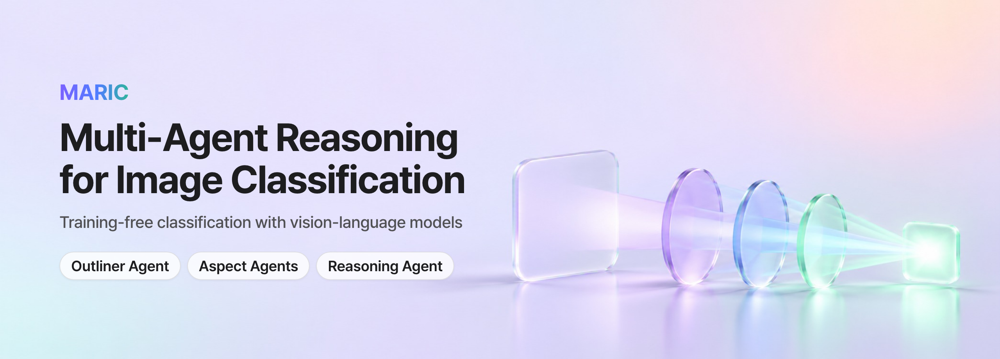
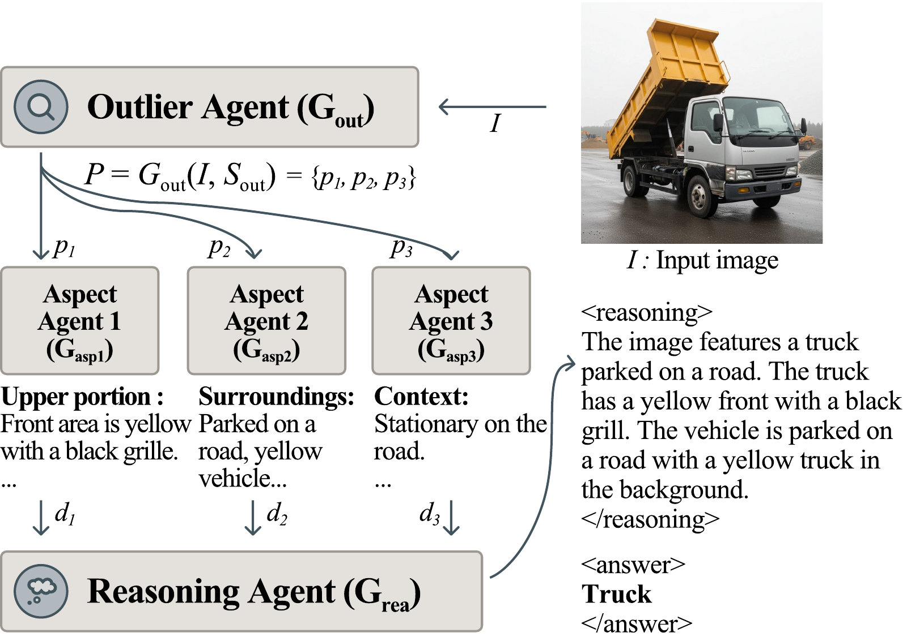
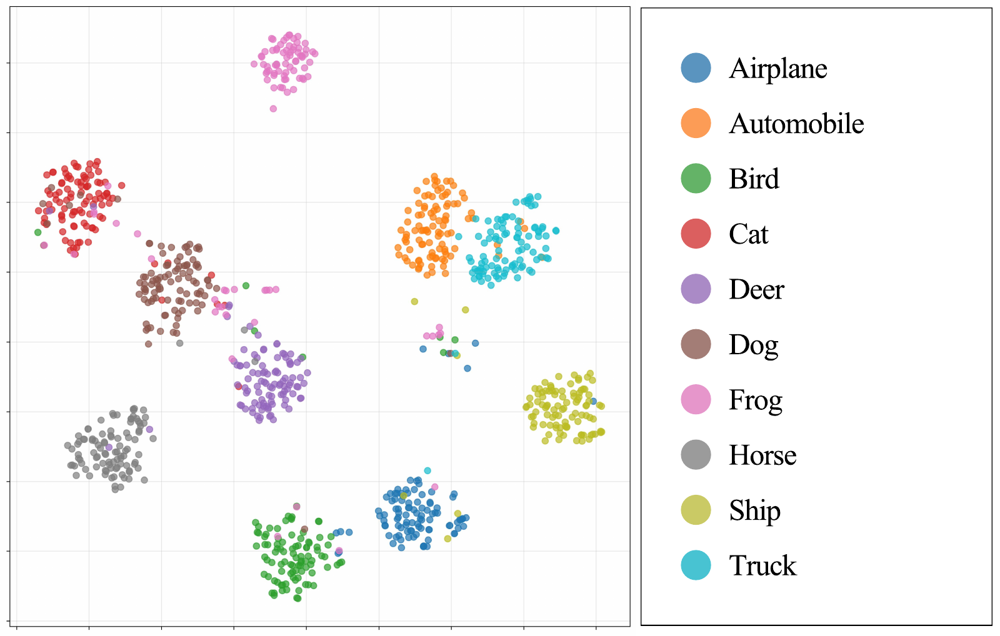

<p align="center">
  
</p>

<p align="center">
  <a href="https://arxiv.org/abs/2509.14860"></a>
  
  
  
  
  <a href="LICENSE"></a>
</p>

<p align="center">
  
  
  
  
  
  
</p>

<p align="center">
  <a href="#how-it-works"><b>How it works</b></a> ·
  <a href="#see-it"><b>See it</b></a> ·
  <a href="#install"><b>Install</b></a> ·
  <a href="#datasets"><b>Datasets</b></a> ·
  <a href="#run-the-experiments"><b>Run</b></a> ·
  <a href="#use-it-in-python"><b>Python</b></a> ·
  <a href="#results"><b>Results</b></a> ·
  <a href="#citation"><b>Citation</b></a>
</p>

<h2 align="center">Look at the image three ways before naming its class</h2>

<p align="center"><b>One VLM, no training, 1 + K + 1 calls per image.</b></p>

A single prompt gives a vision-language model one look at an image, and it can settle on one cue, such as the background, and miss the detail that separates two classes. MARIC splits that one look into three roles. An Outliner Agent decides what to look at, K Aspect Agents (three by default) each describe one of those aspects, and a Reasoning Agent reads the descriptions and picks the class.

```text
image + candidate classes
   │
   ▼
Outliner Agent      1 call    three {prefix, postfix} prompts: where to look, what to describe
   │
   ▼
Aspect Agents       K calls   one description per prompt, written without naming any class
   │
   ▼
Reasoning Agent     1 call    REASONING: ...   ANSWER: <class index>
```

No model parameter is updated. With LLaVA 1.5-13B, MARIC averaged 81.23% accuracy over four benchmarks, against 73.85% for the best baseline ([Results](#results)).

<p align="center">
  <a href="https://github.com/gogoymh/maric"></a>
</p>

## How it works

<p align="center">
  
</p>

Given an image $I$ and candidate labels $\mathcal{Y}$, MARIC predicts a label $\hat{y} \in \mathcal{Y}$ and returns the reasoning behind it. The three steps follow Section 3 of the paper, and each runs on the same VLM.

1. **Outline.** The Outliner Agent reads the image and the label set and writes $K$ prompts, $\mathcal{P} = G_{out}(I, \mathcal{Y})$. Each prompt has a *prefix* that says where to look ("Focus on the upper portion of the primary object") and a *postfix* that says what to describe ("Describe its shape, texture, and any protrusions"). The prompts are meant to overlap as little as possible: the default three cover the object itself, its context and the details that separate confusable labels.
2. **Describe.** Each Aspect Agent is a separate VLM call that answers one prompt, $d_k = G_{asp}(I, p_k)$. It reports visible properties (material, texture, lighting, structure) in under 50 words and may not name any class, so the evidence is written before a label is chosen.
3. **Reason.** The Reasoning Agent receives the image, the numbered class list and the descriptions, $(\hat{y}, r) = G_{rea}(I, \mathcal{Y}, D)$. It weighs the descriptions against each other and answers in two parts: `REASONING`, the trace $r$, and `ANSWER`, the index of the chosen class.

The agents' instructions are plain text files in [`prompts/`](prompts/), one folder per agent.

Two fallbacks in the code are worth knowing when you read the logs. If the Outliner's reply cannot be parsed into three prompts, MARIC uses three fixed ones (main subject, background, and colors and textures). If the Reasoning Agent's answer holds no valid class index, the prediction falls back to the first class in the list.

## See it

The example of Figure 1: a CIFAR-10 image of a truck. The quoted text is as printed in the figure, which shortens it with "...".

```text
Outliner   p1  upper portion
           p2  surroundings
           p3  context

Aspect 1   "Front area is yellow with a black grille. ..."
Aspect 2   "Parked on a road, yellow vehicle..."
Aspect 3   "Stationary on the road. ..."

Reasoning  "The image features a truck parked on a road. The truck has a yellow
            front with a black grill. The vehicle is parked on a road with a
            yellow truck in the background."
Answer     Truck
```

Every run keeps this record. For the first `--log_samples` images, the log stores the Outliner's prompts, each Aspect Agent's description, the Reasoning Agent's full reply, the predicted and true labels and the exact prompt each agent received.

## Install

The experiments run in Docker on NVIDIA GPUs. The image is built on `nvcr.io/nvidia/pytorch:25.06-py3` and installs [`requirements.txt`](requirements.txt).

```bash
chmod +x docker_build.sh
./docker_build.sh            # builds maric:latest and starts a container named "maric"
docker exec -it maric bash   # open a shell in it
```

The container gets every GPU (`--gpus all`) and mounts the repository at `/app`, so datasets, logs and results stay on the host. The LLaVA weights are downloaded from Hugging Face on first use.

## Datasets

| Dataset | Classes | Images evaluated | How to get it |
|---|---|---|---|
| CIFAR-10 | 10 | 1,000 (100 per class) | downloaded automatically |
| [OOD-CV](https://bzhao.me/OOD-CV/) | 10 | 1,000 (100 per class) | manual download, see below |
| [Weather](https://www.kaggle.com/datasets/pratik2901/multiclass-weather-dataset) | 4 (sunrise, shine, rain, cloudy) | 1,125 | downloaded automatically with `kagglehub` |
| [Skin Cancer](https://www.kaggle.com/datasets/fatemehmehrparvar/skin-cancer-detection) | 2 (healthy, cancerous) | 174 (87 per class) | downloaded automatically with `kagglehub` |

OOD-CV has to be downloaded by hand from https://bzhao.me/OOD-CV/ and extracted into the repository root:

```text
OOD-CV-Cls/
├── phase-1/
└── phase-2/
```

CIFAR-10 and OOD-CV are always sampled at 100 images per class with a fixed seed (42), and the chosen indices are cached, so every run sees the same images.

## Run the experiments

`experiment.sh` runs the paper's eight configurations: four datasets with `llava-7b` (batch size 32) and `llava-13b` (batch size 16), on GPUs 0 to 3. It writes each run's console output to `experiments/`, so create that folder first.

```bash
mkdir -p experiments
bash experiment.sh
```

To run one configuration yourself:

```bash
python3 main.py --datasets cifar10 --methods maric --vlm llava-7b --batch_size 32 --gpu_ids 0 1 2 3
```

| Option | Default | Meaning |
|---|---|---|
| `--datasets` | all four | any of `cifar10`, `oodcv`, `weather`, `skin_cancer` |
| `--methods` | `maric` | `maric` is the only method in this repository |
| `--vlm` | `llava-7b` | `llava-7b` (`llava-hf/llava-1.5-7b-hf`) or `llava-13b` (`llava-hf/llava-1.5-13b-hf`) |
| `--num_samples` | all | images per dataset; CIFAR-10 and OOD-CV always use 100 per class |
| `--batch_size` | automatic | chosen from the free GPU memory when not set |
| `--gpu_ids` | none | several GPUs to split the images across, e.g. `--gpu_ids 0 1 2 3` |
| `--gpu_id` | automatic | one GPU; without it, the GPU with the most free memory |
| `--multi_gpu` | off | use every GPU with enough free memory |
| `--log_samples` | 5 | how many images to log in full detail |
| `--output_dir` | `results` | where results are written |

Each run writes its results to `results/<timestamp>/results.json` and the detailed per-image records to `results/<timestamp>/logs/`. Generation uses greedy decoding.

## Use it in Python

```python
from PIL import Image

from maric_framework import MARIC
from vlm_models import create_vlm_model

vlm = create_vlm_model("llava-7b")   # loads llava-hf/llava-1.5-7b-hf
maric = MARIC(vlm_model=vlm, class_names=["airplane", "automobile", "bird", "cat", "deer",
                                          "dog", "frog", "horse", "ship", "truck"])

result = maric.classify(Image.open("truck.jpg").convert("RGB"))
result["answer"]         # the predicted class name, lower-cased
result["reasoning"]      # the Reasoning Agent's trace
result["prompts"]        # the Outliner's three {"prefix", "postfix"} prompts
result["descriptions"]   # one description per Aspect Agent
```

`maric.predict(image)` returns only the class name, and `classify_batch` and `predict_batch` take lists of images. Run these from the repository root, because the prompt files are read from `prompts/` relative to the working directory.

To try different instructions, add a file such as `prompts/outliner_agent/outliner_agent_v2.txt` and select it with `MARIC(..., prompt_versions={"outliner": "v2", "aspect": "v1", "reasoning": "v1"})`.

## Results

> [!NOTE]
> These are the results reported in the paper. Every method is evaluated zero-shot, with no parameter update, on the same backbone within each block (`llava-1.5-7b-hf` or `llava-1.5-13b-hf`, temperature 0). The baselines are Direct Generation, Chain-of-Thought (CoT) and Single-Agent Visual Reasoning (SAVR), where one handcrafted prompt asks for the reasoning and the class in a single pass. This repository contains MARIC only; the baselines are not included.

**Main results** (the paper's Table 1): classification accuracy (%). The best result in each block is in bold.

| LLaVA 1.5-7B | CIFAR-10 | OOD-CV | Weather | Skin Cancer | Average |
|---|---:|---:|---:|---:|---:|
| Direct Generation | 64.8 | 66.5 | 50.2 | **50.6** | 58.03 |
| Chain-of-Thought | 83.5 | 80.8 | **70.1** | 50.0 | 71.10 |
| SAVR | 75.6 | 55.5 | 48.0 | 49.4 | 57.13 |
| MARIC | **90.8** | **81.9** | 65.6 | **50.6** | **72.23** |

| LLaVA 1.5-13B | CIFAR-10 | OOD-CV | Weather | Skin Cancer | Average |
|---|---:|---:|---:|---:|---:|
| Direct Generation | 86.6 | 86.2 | 21.7 | 52.9 | 61.85 |
| Chain-of-Thought | 88.0 | 75.2 | 81.1 | 49.4 | 73.43 |
| SAVR | 88.6 | 81.2 | 63.0 | **62.6** | 73.85 |
| MARIC | **93.5** | **89.9** | **85.2** | 56.3 | **81.23** |

- MARIC had the highest average with both backbones. With LLaVA 1.5-13B it led the second-best method, SAVR, by 7.38 points and was best on CIFAR-10, OOD-CV and Weather, by 4.9, 3.7 and 4.1 points.
- With LLaVA 1.5-7B the average lead over CoT was 1.13 points. MARIC was 7.3 points ahead on CIFAR-10, and CoT was 4.5 points ahead on Weather (70.1 against 65.6).
- On Skin Cancer no method was far from chance with the 7B model (49.4 to 50.6 on a balanced two-class set), and with the 13B model SAVR led MARIC by 6.3 points. The paper reads this as a sign that medical images need more domain-specific aspect prompts than the general ones used here.

**Aspect Agents** (Table 2): LLaVA 1.5-13B, accuracy (%).

| Configuration | CIFAR-10 | OOD-CV | Weather | Skin Cancer |
|---|---:|---:|---:|---:|
| Full MARIC | 93.5 | 89.9 | 85.2 | 56.3 |
| Without Aspect Agents | 93.4 | 89.4 | 84.5 | 52.9 |

Removing the Aspect Agents lowered accuracy on all four datasets, by 0.1 to 0.7 points on the three natural-image sets and by 3.4 points on Skin Cancer.

**What the reasoning encodes** (Figure 2): the Reasoning Agent's text for each CIFAR-10 image, embedded with E5 and projected with t-SNE, colored by true class.

<p align="center">
  
</p>

The classes form separate clusters. Animal classes sit apart from vehicle classes, and the bird and airplane clusters lie close together.

**Human study** (Table 3): eleven AI researchers and data scientists rated the three aspects and their descriptions for 30 random CIFAR-10 images on a 5-point scale.

| Aspect relevance | Aspect diversity | Description accuracy |
|---:|---:|---:|
| 3.93 ± 1.08 | 3.97 ± 1.07 | 4.00 ± 1.05 |

## Limits

- **Cost.** One image takes 1 + K + 1 VLM calls, five by default, so latency and token use are higher than with a single prompt. The paper does not report these costs yet.
- **Prompt quality.** If the Outliner writes overlapping or off-target prompts, the Aspect Agents repeat each other or miss the deciding cue.
- **Fixed K.** The experiments use K = 3 throughout, which may not suit every domain.
- **Evidence so far.** Two LLaVA 1.5 backbones and four datasets with at most 1,125 images each, evaluated on class-balanced samples.

## Repository layout

```text
main.py                       experiment runner and command-line options
maric_framework.py            OutlinerAgent, AspectAgent, ReasoningAgent and the MARIC pipeline
vlm_models.py                 the LLaVA wrapper and create_vlm_model
prompt_manager.py             loads and formats the prompt files, by agent and version
prompts/                      one folder per agent, e.g. outliner_agent/outliner_agent_v1.txt
experiment_logger.py          per-image records of every agent's input and output
test_all_datasets_random.py   dataset download and loaders
experiment.sh                 the eight runs of the paper
Dockerfile, docker_build.sh   the container
docs/assets/                  README images and their sources
```

## Citation

MARIC is the method of the paper **[MARIC: Multi-Agent Reasoning for Image Classification](https://arxiv.org/abs/2509.14860)** (arXiv:2509.14860).

```bibtex
@misc{seo2025maric,
  title         = {{MARIC}: Multi-Agent Reasoning for Image Classification},
  author        = {Seo, Wonduk and Yu, Minhyeong and An, Hyunjin and Lee, Seunghyun},
  year          = {2025},
  eprint        = {2509.14860},
  archivePrefix = {arXiv},
  primaryClass  = {cs.CV},
  url           = {https://arxiv.org/abs/2509.14860},
  note          = {Wonduk Seo and Minhyeong Yu contributed equally}
}
```

## License

[MIT](LICENSE)

<p align="center">
  <a href="https://github.com/gogoymh/maric"></a>
</p>
